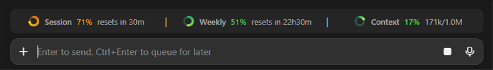

# Claude Code Usage Monitor



Built for the **Claude desktop app** (Code tab), and that is where it is tested. It also loads in Claude Code in a terminal (PowerShell included), but how it looks there hasn't been checked yet.

A live usage bar above the chat box in Claude Code. It shows three things at a glance, each with an activity ring that turns from green to amber to red as it fills:

- **5-hour limit**: your rolling 5-hour usage limit, and when it resets
- **Weekly**: your 7-day usage limit, and when it resets
- **Context**: how much of the current chat's context window is used

Click either reset time to switch both between the clock time it resets at (`4:30 PM`, `Sat 9:00 AM`) and a countdown (`47m`, `2d 14h`). Every chat remembers your choice.

The 5-hour and weekly limits belong to your account, so every open chat shows the latest figures, even one you haven't sent a message in yet. Once a limit resets, it shows 0% until your next reply brings a fresh reading. In the desktop app's Code tab a brand-new chat shows the bar after your first message, when its session starts; the Chat tab doesn't run plugins, so the bar isn't there. The bar adapts to the window width. Limits appear on Claude subscription plans (Pro, Max); with an API key only Context is shown.

## Install

The plugin is called **usage-monitor**.

**Claude desktop app (Code tab):** click **+** next to the prompt box, then **Plugins** → **Add marketplace**, and enter `TheRedViperV/claude-code-usage-monitor`. Then click **Add plugin**, pick **usage-monitor**, and start a new chat.

If the desktop app's marketplace list stays empty, install it from PowerShell instead and restart the app. A plugin installed for your user loads in the desktop app's Code tab too:

```
claude plugin marketplace add TheRedViperV/claude-code-usage-monitor
```

```
claude plugin install usage-monitor@claude-code-usage-monitor
```

**Claude Code in a terminal**, at the prompt:

```
/plugin install usage-monitor --marketplace TheRedViperV/claude-code-usage-monitor
```

Answer `y` to add the marketplace, then choose the user scope so it appears in every session.

### Upgrading from token-meter

Versions before 0.4.1 were called `token-meter`. Remove it so the bar doesn't show twice:

```
claude plugin uninstall token-meter@claude-code-usage-monitor
```

## License

MIT
